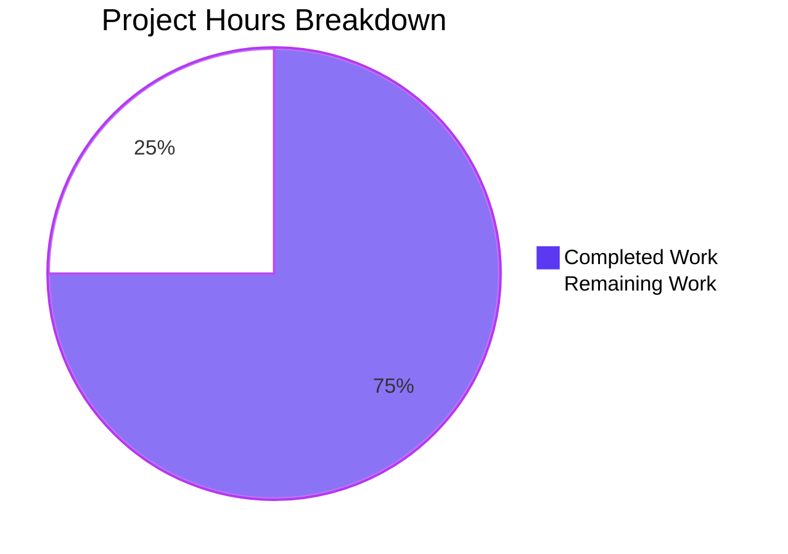
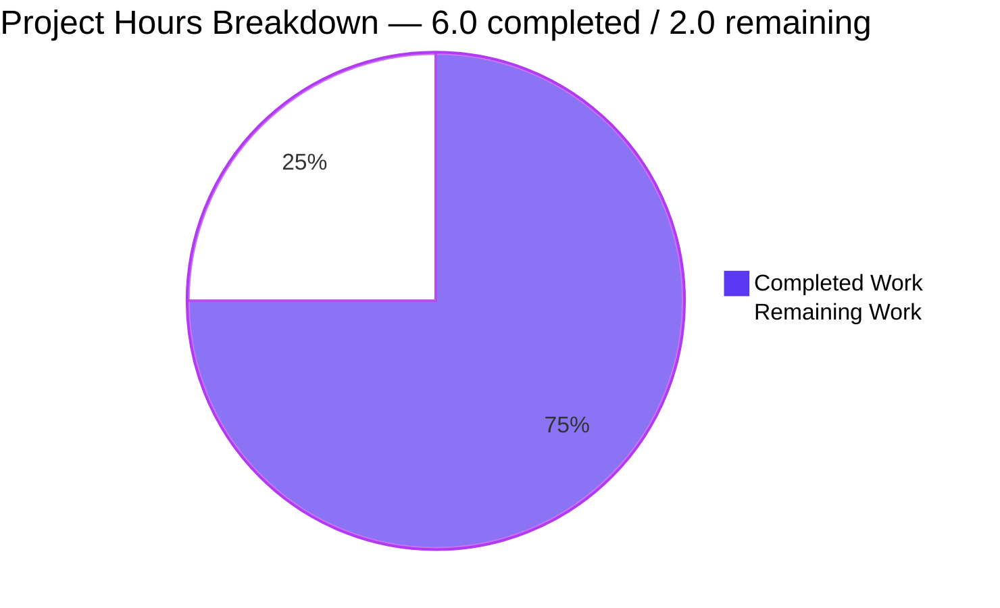
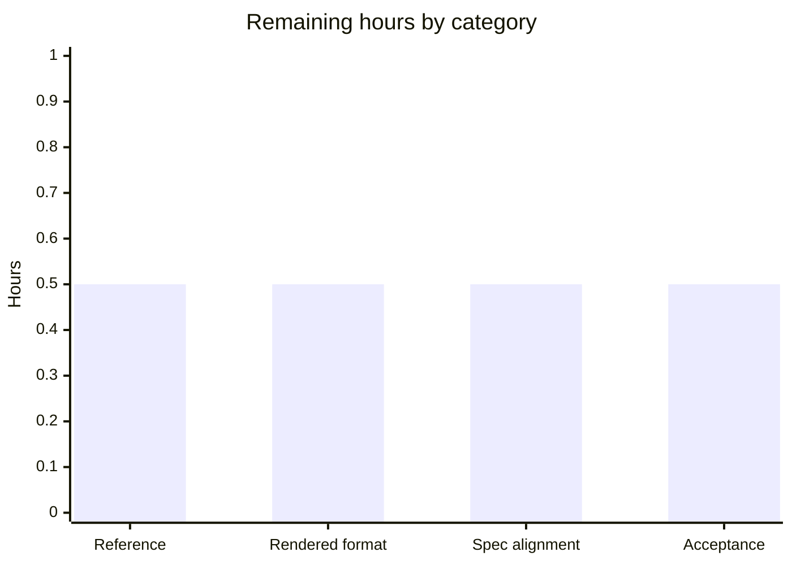

# 1. Executive Summary

## 1.1 Project Overview

This project carried one user direction — "do nothing just chill take a chill pill have fun", repeated six times, naming no product, feature, technology or acceptance criterion — and delivered the record that returns it to its owner with the interpretation that follows. That record, `NO_WORK_PERFORMED.md` at the repository root, states the direction verbatim, explains why no engineering work follows, records that nothing already in the repository was changed, and points to the specification holding the full interpretation. The only other file is a pre-existing two-line `README.md`, left byte-identical to its committed state. No runtime, dependency, build, test or deployment surface exists.

## 1.2 Completion Status

Completion of the work scoped for this project: **6.0 of 8.0 engineering hours — 75% complete**.



| Metric | Hours |
|---|---|
| Total Hours | 8.0 |
| Completed Hours (AI + Manual) | 6.0 |
| Remaining Hours | 2.0 |
| Percent Complete | 75% |

## 1.3 Key Accomplishments

- Delivered `NO_WORK_PERFORMED.md` at the repository root, in the form the specification fixes for it.
- Reproduced the direction verbatim, all six identical lines, matching the preserved direction byte for byte.
- Stated plainly, with reasons, that the direction names no requirement, technology, deliverable or acceptance evidence.
- Recorded the no-change outcome, the absence of any dependency, and the read-only inspection behind the record.
- Left `README.md` byte-identical to its committed state; added no other file, manifest or test.
- Kept every excluded category out: no stack, architecture, integration, API, component, data model or UI.
- Verified the document's structure and every factual claim against the tree.
- Confirmed the change set is a single addition: one file added, nothing modified or deleted.

## 1.4 Critical Unresolved Issues

Four of the 31 items scoped for this project remain open: three path-to-production items and one specification sentence the delivered record cannot correct.

| Issue | Impact | Owner | ETA |
|---|---|---|---|
| The record's reference element names an external location that does not resolve, and the path it carries is machine-specific (1 item) | A reader following the record's only reference reaches nothing | Repository owner | 0.5 h |
| The record's rendered output has never been exercised: its format is verified structurally, never through a renderer (1 item) | A rendering defect in a stricter renderer would surface only after publication | Repository owner | 0.5 h |
| The specification's own description of this checkout is inaccurate (1 item) | A reader of the specification alone acts on a false premise about the repository | Specification owner | 0.5 h |
| Acceptance review and merge of the delivered record (1 item) | The branch stands one commit ahead of the main line, unsigned-off | Repository owner | 0.5 h |

## 1.5 Access Issues

No access issues identified. No credential, service, database or network endpoint was needed or supplied; the single reference that does not resolve is a document location, not an access-restricted resource.

## 1.6 Recommended Next Steps

1. [High] Resolve the record's reference element so its reader can reach the interpretation it points to.
2. [Medium] Exercise the document through a Markdown renderer and adopt that check for documentation changes.
3. [Medium] Complete the acceptance review of the delivered record and merge the branch.
4. [Low] Correct the specification's description of this checkout so downstream readers are not misled.

# 2. Project Hours Breakdown

## 2.1 Completed Work Detail

| Component | Hours | Description |
|---|---|---|
| Direction record — verbatim block | 1.0 | The direction reproduced in the user's own words, including its sixfold repetition, in a fenced text block (`NO_WORK_PERFORMED.md:5-19`) |
| Direction record — the no-work finding | 1.0 | The plain statement that the direction names no requirement, technology, deliverable or acceptance evidence, with the reason no work follows and the finding that nothing is deferred (`NO_WORK_PERFORMED.md:21-23`) |
| Direction record — no-change record and reference | 1.0 | What was left unchanged, what was not added, and the pointer to the specification that holds the full interpretation (`NO_WORK_PERFORMED.md:25-31`) |
| Requirement fidelity and claim verification | 2.0 | Byte-level comparison of the directive block against the preserved direction (equal digests), structural verification (fences, heading sequence, encoding, whitespace, byte and line counts) and claim-by-claim verification of every factual statement against the tree |
| Tree, history and non-regression work | 1.0 | Confirmation that `README.md` is byte-identical to its committed blob, that no manifest or dependency exists, that no excluded artefact was introduced and that no consumer references the record, followed by the single-file commit `7cdfbb2` |
| **Total** | **6.0** | |

## 2.2 Remaining Work Detail

| Category | Hours | Priority |
|---|---|---|
| Make the record's external reference resolvable (reference element of the deliverable) | 0.5 | High |
| Validate the record's rendered format through a Markdown renderer (documentation quality validation) | 0.5 | Medium |
| Align the specification's description of this checkout with the repository's actual state (specification statement) | 0.5 | Low |
| Acceptance review and sign-off of the delivered record (path to production) | 0.5 | Medium |
| **Total** | **2.0** | |

# 3. Test Results

The repository contains no test suite — no runner, fixtures, test files or coverage tooling — so the verification below is the set of checks executed against the delivered document and the tree, with the counted outcome. Every figure is a result observed in this checkout at the commit under review (`7cdfbb2`), not an estimate.

| Area / Category | Framework | Tests | Passed | Failed | Coverage | What This Proves |
|---|---|---|---|---|---|---|
| Deliverable existence, path, type and permissions | stdlib Python checks | 3 | 3 | 0 | n/a — no coverage tooling | The deliverable is a regular, non-empty 1642-byte Markdown file at the repository root with plain non-executable permissions |
| Document structure and encoding | stdlib Python checks | 3 | 3 | 0 | n/a — no coverage tooling | The document is well-formed: paired fences, heading sequence 1/2/2/2/2 with no level jump, UTF-8 without BOM, LF-only, no tabs, no trailing whitespace, final newline present |
| Direction fidelity, content elements and prohibitions | stdlib Python checks | 8 | 8 | 0 | n/a — no coverage tooling | The direction appears as six whole lines with no extra text and its directive block is byte-identical to the preserved direction; all four content elements are present in order; no placeholder marker, product claim, technology proposal or next step appears |
| Content hygiene, security and consumers | stdlib Python checks | 4 | 4 | 0 | n/a — no coverage tooling | No credential, secret or injection payload; the record does not repeat the inaccurate statement about the checkout; nothing in the tree consumes the record |
| Change set and repository gates | git | 6 | 6 | 0 | n/a — no coverage tooling | The change set since the base commit is a single addition with nothing modified, deleted or renamed; no manifest, dependency, source, test or container artefact introduced; tracked set is the two expected files; working tree clean and the whitespace gate clean |
| Pre-existing content continuity | git | 1 | 1 | 0 | n/a — no coverage tooling | `README.md` is byte-identical to its committed blob at the base commit |
| External reference resolution | stdlib Python checks | 1 | 0 | 1 | n/a — no coverage tooling | The record's reference target does not exist at its declared location — the one open failure |
| **Total** | | **26** | **25** | **1** | | |

**Not Covered**

- **Rendered output.** The document has never been exercised through a Markdown renderer or linter; its validity rests on structural checks of fences, headings, encoding and whitespace. A human should render it before publication.
- **The reference target.** No document exists at the location the record's reference names, so following that reference has never succeeded. A human must establish where the referenced documentation is published.
- **Runtime behaviour of any kind.** The repository holds no application, service, endpoint, script, command or configuration, so nothing was started, requested, navigated or clicked, and no browser session was possible.
- **Dependency and packaging surfaces.** No manifest, lockfile or dependency exists, so no installation, upgrade, compatibility or vulnerability check applies.
- **Coverage measurement.** No coverage tooling exists in the repository, so no coverage figure is reported for any check above.
- **Test-suite behaviour.** There is no test suite to run; the checks above are repository and document gates executed directly, and no assertion exists that would fail on a future change to the document.

# 4. Runtime Validation & UI Verification

Nothing in this repository runs, so runtime validation is a statement about what exists to be driven rather than a set of executed journeys. What was driven is the repository itself: its state, its change set and the delivered document.

- ❌ **Application start-up** — no entry point, module, script or binary exists; there is nothing to start.
- ❌ **HTTP/API surface** — no server, route or listening socket exists; no request could be issued.
- ❌ **User interface** — no page, template, stylesheet or rendered asset exists; no screen could be driven.
- ❌ **Database and persistence** — no schema, client or data store is configured or referenced.
- ❌ **Authentication and session flows** — no identity, token or session surface exists.
- ❌ **External integrations** — no service, webhook, queue or credential is referenced or configured.
- ✅ **Repository state** — working tree clean and the whitespace gate clean, verified at the commit under review.
- ✅ **Change-set validation** — exactly one file added since the base commit; nothing modified, renamed or deleted.
- ✅ **Delivered document** — existence, permissions, structure, encoding, byte and line counts, six directive occurrences and every factual claim verified against the tree.
- ⚠ **Rendered output** — never exercised through a renderer; validity is structural only, and this is the single runtime-equivalent gap in the delivery.

The delivered artefact is a document, and it was exercised as one: read in full, checked line by line against the direction it preserves, and checked claim by claim against the repository. Nothing in the repository was ever exercised at runtime because nothing in the repository is executable.

# 5. Compliance & Quality Review

## 5.1 Compliance Matrix

| Deliverable / Benchmark | Status | Verification | Evidence |
|---|---|---|---|
| Deliverable created at the specified path and name | ✅ Pass | Verified | `NO_WORK_PERFORMED.md` at the repository root, commit `7cdfbb2` |
| Change set limited to the deliverable | ✅ Pass | Verified | Diff against the base commit is one addition; nothing modified, deleted or renamed |
| Direction reproduced verbatim with its repetition | ✅ Pass | Verified | Lines 5-19; six whole-line occurrences; block digest equal to the preserved direction |
| No-requirement finding stated plainly, with reasons | ✅ Pass | Verified | Line 23 |
| No-change record present and accurate | ✅ Pass | Verified | Line 27, checked against the tree and the change set |
| Reference to the specification present as specified | ⚠ Partial | Verified | Line 31; the named target does not resolve (see 5.2) |
| Prohibitions observed (no product claim, technology or next step) | ✅ Pass | Verified | Full-document vocabulary sweeps return no unnegated product, technology or next-step statement |
| Excluded categories absent from the repository | ✅ Pass | Verified | Census: two Markdown files and nothing else; no code, configuration, CI, container or test artefact |
| Zero dependencies and no manifest | ✅ Pass | Verified | No manifest, lockfile or dependency directory anywhere in the tree |
| Documentation quality and hygiene | ✅ Pass | Verified | No placeholder or deferred-work markers; plain Markdown consistent with the repository's existing style |
| Security posture of the delivered content | ✅ Pass | Verified | No credentials, secrets, injection sinks or executable content; both files plain 644 text |
| Pre-existing repository content preserved | ✅ Pass | Verified | `README.md` blob identical to the base commit |

## 5.2 AAP & Rule Divergences and Gaps

No user-specified rules were provided for this project, so each entry below is a departure from the specification; each is either accuracy-driven or accepted with a caveat, and none is an unaddressed defect.

| What the AAP Required | What Was Delivered Instead | Why It Diverged | Impact | Remediation |
|---|---|---|---|---|
| The no-change element stated literally as "no command was run" | "no command was run that changes the repository or its contents — the operations carried out were read-only inspections" (`NO_WORK_PERFORMED.md:27`) | Read-only inspections were performed to establish the record's claims, so the literal wording would have asserted something false; the accuracy standard the specification itself sets outranks literal fidelity | Wording-level only: a reader comparing the record with the specification text sees a qualification; no behavioural, security or correctness consequence | None required — accept the wording, or amend the specification's phrasing if literal fidelity is preferred |
| No statement about the checkout's state; the specification asserts the working directory "is empty and is not a git repository" | The record makes no claim about the checkout's state, and does not repeat the assertion | The assertion is contradicted by the repository itself, which is a git repository holding two tracked files, one of them pre-existing; repeating it would have put a false statement into an artefact whose value is accuracy | Reader-level: anyone consulting the specification alone acts on a false premise about this repository; the delivered record is unaffected | Correct or remove that sentence in the specification (0.5 h); no repository change is needed |
| The record must point to the specification as the full record of the interpretation | A reference naming the specification's declared external location (`NO_WORK_PERFORMED.md:31`) | That location is the one the specification fixes, and copying the specification into the repository is excluded from scope; nothing exists at the location on this machine, and the path is machine-specific | Reader-level: the record's only reference does not resolve for anyone who follows it | Repoint the reference to where the specification is published, or place the document at the named location (0.5 h, carried in 2.2) |

The qualified no-change wording is deliberate and correct as written. Read-only inspection is what produced every verified claim in this delivery, so a literal "no command was run" would have contradicted the record's own accuracy. The wording keeps the element's meaning — no file was created, modified or deleted, no dependency was added, and nothing was run that changes the repository — while stating truthfully what was in fact executed. A reader comparing the record against the specification's exact phrasing should treat the qualification as intentional rather than as an omitted element; no code or document change is needed to close it, and the alternative would be to soften the specification's phrasing.

The specification's description of this checkout is the one statement in the project the delivered work could not correct, because it lives in the specification and not in the repository. It describes the working directory as empty and outside version control, whereas the checkout is a git repository containing `README.md` at the base commit and the delivered record afterwards. The record's accuracy is unaffected — it asserts nothing about the checkout's state — but anyone reading the specification without opening the repository will form a false picture of what the work had to preserve. The fix belongs in that document: 0.5 h for whoever maintains it, and no action for a developer working in the repository.

The record's reference is the only element of the delivery that a reader cannot follow to its end. It names an absolute location outside the repository, fixed by the specification's own file plan, which also forbids copying the referenced document into the repository — so the text is exactly what was asked for, yet nothing exists at that location and, being absolute, the path will not resolve on any other machine either. The consequence is confined to the reader's ability to reach the fuller interpretation; the record's own contents are self-contained. Closing it takes 0.5 h: either publish the referenced document at the named location, or reword the reference to point at wherever it is actually published.

# 6. Risk Assessment

Risks below are forward-looking: what could still go wrong for the reader or the repository now that the deliverable exists. None of them is a defect in the delivered document.

| Risk | Category | Severity | Probability | Mitigation | Status |
|---|---|---|---|---|---|
| The record's reference does not resolve and carries a machine-specific absolute path, so a reader following it reaches nothing | Integration | Medium | High — already true | Repoint the reference to where the specification is published, or place the document at the named location | Open |
| No automated check binds to the document: the repository has no build, test, CI or documentation gate, so nothing re-verifies its claims as the tree changes | Technical | Medium | Medium | Add a documentation gate, or re-verify the record whenever the repository changes | Open |
| The record's absolute no-change clause becomes false the moment any further work lands on the branch | Operational | Medium | Medium | Re-scope that clause (`NO_WORK_PERFORMED.md:27`) if work is appended to the repository | Open |
| The document's rendered output has never been exercised, so a rendering defect in a stricter renderer would surface only after publication | Technical | Low | Low | Render or lint the document once, and adopt the check for documentation changes | Open |
| The specification's description of this checkout is inaccurate, so any artefact repeating it asserts something false | Operational | Medium | Medium | Correct the description in the specification | Open |
| The branch stands one commit ahead of the main line with no acceptance sign-off, so the deliverable is not yet part of the main line | Operational | Low | High | Review, approve and merge | Open |
| Repository content could drift from what the record asserts once tooling, dependencies or source files are added to it | Technical | Low | Low | Re-read the record's no-change clauses whenever repository contents change materially | Open |

No security risk row is warranted and none is listed: the tree holds no dependency, executable content, credential, input surface, session, route or rendered output, and the only hygiene consideration — a machine-specific absolute path published in the record — is carried as the first risk above with its impact.

# 7. Visual Project Status

Progress is measured against the engineering hours scoped for this project. Completed work is shown in dark blue, remaining work in white, and the same figures appear in Sections 1.2 and 2.2.





Priority distribution of the remaining 2.0 hours, matching Section 2.2:

| Priority | Items | Hours |
|---|---|---|
| High | 1 | 0.5 |
| Medium | 2 | 1.0 |
| Low | 1 | 0.5 |
| **Total** | **4** | **2.0** |

# 8. Summary & Recommendations

This project delivered what was scoped for it: a single document, `NO_WORK_PERFORMED.md` at the repository root, that returns a direction naming no product, feature, technology or acceptance criterion, states plainly why no engineering work follows from it, records that nothing already in the repository was changed, and points to the specification holding the full interpretation. The direction appears in the user's own words, all six identical lines of it, in a block whose digest matches the preserved direction exactly. The change set since the base commit is one file added and nothing else: no existing file created, modified, renamed or deleted, no dependency declared, no manifest, test, configuration or container artefact introduced, and nothing in the tree reading the record. That outcome is what the direction required, and it is verified rather than assumed.

Completion of the scoped work stands at **75% — 6.0 of 8.0 engineering hours**. The completed hours cover the record's content, verification of every claim it makes against the repository, and confirmation that nothing else changed. The remaining 2.0 hours are four items of 0.5 h each: making the record's reference resolvable, exercising the document through a Markdown renderer, correcting the specification's description of this checkout, and completing the acceptance review and merge of the branch. Only the first touches the delivered document itself.

The critical path to publication is short. First, the record's reference element — its only external pointer — names a location at which nothing exists, and because the path is absolute it will not resolve on any other machine either; resolving it takes 0.5 h and is the single item a reader would notice. Second, the document's rendered format should be exercised once through a renderer, since its validity has so far been established structurally; the same 0.5 h also gives the repository a documentation check it does not have. Third, the specification's own description of this checkout should be corrected by whoever maintains it, because the delivered record correctly avoids repeating an inaccurate statement about the repository. Acceptance review and merge then close the work.

Production readiness for this deliverable is high, with the usual caveat of an unexercised rendered format. The artefact is self-contained plain text, 1642 bytes, free of credentials, injection surfaces and executable content, and it introduces no dependency, service or runtime to operate, monitor or secure. Nothing in the repository executes, so there is no availability, performance or attack surface to assess. The residual risk is reader-facing rather than operational: a reference that does not resolve, and a specification sentence that mis-describes the repository.

| Success Metric | Result |
|---|---|
| Scoped deliverables delivered | 1 of 1 |
| Change set against the base commit | 1 file added, nothing modified, deleted or renamed |
| Direction fidelity | Six whole lines; directive block digest equal to the preserved direction |
| Excluded categories introduced | 0 |
| Dependencies added | 0 |
| Pre-existing content preserved | `README.md` byte-identical to its committed blob |
| Checks executed / passed | 26 executed, 25 passed, 1 open failure (the reference) |
| Completion against scoped work | 75% (6.0 of 8.0 hours) |

The short version for whoever picks this up: the work the direction allows is complete and verified, the repository is exactly as it was apart from the record, and the four open items are half-hour tasks — a documentation reference, a rendering check, a sentence in the specification, and an approval.

# 9. Development Guide

**System prerequisites.** Only `git` is required, verified here as 2.54.0. The repository has no runtime, dependency, build or test surface, so nothing else is needed to work with or review it. Present on this machine but unused by the project: Node.js v22.23.3 with npm 11.21.0, Python 3.13.7 with pip 25.3, Docker 29.7.2 with compose 5.4.0, Git LFS 3.7.1, Google Chrome 155.0.8059.84, and the Mermaid CLI 12.0.0.

**Environment setup.** Clone the repository and check out the delivered state. There is nothing to configure: no environment file, no variable, no secret, no service, no port and no data store.

```bash
git clone <repository-url>
cd <repository-directory>
git checkout 7cdfbb2        # the delivered state; also the branch head
```

**Dependency installation.** None. Do not run a package manager here. `npm install`, `pip install -r requirements.txt`, `mvn`, `cargo build` and `docker compose up` all have nothing to act on: there is no manifest, lockfile, module or container definition in the tree, and adding one is outside the scope this repository was directed to deliver.

**Application start-up.** Nothing starts. The repository contains no entry point, service, daemon, scheduled job, port or background process, so there is no start-up sequence to follow and nothing to stop afterwards.

**Verification steps.** Run these from the repository root; they are the checks behind Sections 3 and 4, and each shows the output to expect.

```bash
# 1. You are at the delivered state
git log --oneline -1
# 7cdfbb2 Record that the user's direction requires no work

# 2. The branch adds exactly one file and changes nothing else
git diff --name-status 098dc38..HEAD
# A	NO_WORK_PERFORMED.md

# 3. Tracked files
git ls-files
# NO_WORK_PERFORMED.md
# README.md

# 4. Repository gates: clean tree, no whitespace errors
git status --porcelain && git diff --check
# (no output)

# 5. The pre-existing file is untouched
git diff --stat 098dc38..HEAD -- README.md
# (no output)

# 6. The delivered document's structure
python3 - <<'EOF'
from pathlib import Path
t = Path("NO_WORK_PERFORMED.md").read_text(encoding="utf-8")
lines = t.splitlines()
print("bytes:", len(t.encode("utf-8")), "| lines:", len(lines))
print("fence markers:", sum(1 for l in lines if l.startswith("`" * 3)))
print("headings:", [len(l) - len(l.lstrip("#")) for l in lines if l.startswith("#")])
print("direction occurrences:", t.count("do nothing just chill take a chill pill have fun"))
EOF
# bytes: 1642 | lines: 31
# fence markers: 2
# headings: [1, 2, 2, 2, 2]
# direction occurrences: 6

# 7. The record's external reference (read Troubleshooting before acting on it)
sed -n '31p' NO_WORK_PERFORMED.md
```

**Example usage.** The deliverable is a document, so using it means reading it:

```bash
sed -n '1,31p' NO_WORK_PERFORMED.md
```

It contains, in order: the direction in the user's own words in a fenced block, an explanation of why no engineering work follows from it, a record of what was left unchanged, and a pointer to the specification holding the full interpretation. There is no command, API, CLI or interactive surface to exercise — if you are looking for something to run, this repository has nothing to run by design.

**Troubleshooting.**

| Symptom | Cause | Resolution |
|---|---|---|
| `git status --porcelain` prints a changed file | A local edit, not part of the delivery | Revert it with `git checkout -- <file>`, or commit it deliberately as new work |
| Following the record's reference reaches nothing | The reference names the specification's declared absolute location, which is specific to the machine that wrote it | Obtain the specification from wherever this branch is published; rewording the reference is open work (Section 1.4) |
| `git diff --check` prints nothing on a fresh checkout | Correct behaviour — no whitespace errors are present | No action |
| `npm install`, `npm test`, `pytest` or `docker compose up` fails or has nothing to do | There is no manifest, test suite or container definition in the repository | Do not add one; the repository was directed to contain only the delivered record |
| The platform directories appear empty or absent from git | Git does not track empty directories | No action — they are scaffolding, not part of the delivery |
| A renderer shows the document differently than expected | The document has only ever been verified structurally, never rendered | Render it once and record the result; this is open work (Section 1.4) |

# 10. Appendices

## A. Command Reference

| Command | Purpose | Expected output |
|---|---|---|
| `git log --oneline 098dc38..HEAD` | List the commits this work added | `7cdfbb2 Record that the user's direction requires no work` |
| `git ls-files` | List tracked files | `NO_WORK_PERFORMED.md`, `README.md` |
| `git diff --name-status 098dc38..HEAD` | Show the change set | `A NO_WORK_PERFORMED.md` |
| `git status --porcelain && git diff --check` | Repository gates: clean tree, no whitespace errors | No output |
| `git diff --stat 098dc38..HEAD -- README.md` | Confirm the pre-existing file is untouched | No output |
| `sed -n '1,31p' NO_WORK_PERFORMED.md` | Read the delivered record | The direction, the no-work finding, the no-change record and the reference |
| `git diff --stat 098dc38..HEAD` | Summarise the change volume | `1 file changed, 31 insertions(+)` |

## B. Port Reference

No ports. This project binds nothing, starts no service, daemon, database, broker or cache, and holds no queue, topic or consumer group. There is no port allocation to plan for and no resource partitioning to perform when the repository is checked out more than once.

## C. Key File Locations

| Path | Role |
|---|---|
| `NO_WORK_PERFORMED.md` | The deliverable: the record of the direction, the no-work finding, the no-change record and the reference |
| `README.md` | Pre-existing two-line repository description, unchanged |
| `blitzy/screenshots`, `blitzy/screen_recordings` | Empty scaffolding directories, holding no files and not part of the delivery |

## D. Technology Versions

The project itself uses a single tool — `git`. Everything else is recorded because it is present on this machine, not because the project needs it.

| Tool | Version | Used by this project |
|---|---|---|
| git | 2.54.0 | Yes — version control, the repository gates and the change set |
| Node.js / npm | v22.23.3 / 11.21.0 | No — no manifest, package or JavaScript file exists |
| Python / pip | 3.13.7 / 25.3 | No — the standard library was used for structural checks only |
| Docker / compose | 29.7.2 / 5.4.0 | No — no image, container or compose file exists |
| Git LFS | 3.7.1 | No — no file is LFS-tracked |
| Google Chrome | 155.0.8059.84 | No — there is no page, service or browser surface to drive |
| Mermaid CLI | 12.0.0 | No — used only to render the diagrams in this report |

## E. Environment Variable Reference

No environment variables and no secrets are supplied, required or read. The repository contains no `.env` file, no configuration template and no code that reads the environment, so a fresh checkout needs no values set to be reviewed or verified.

## F. Developer Tools Guide

- **Required:** `git`, at any recent version.
- **Recommended for reviewing the deliverable:** a Markdown renderer or linter. None is installed here, which is why the document's format has been verified structurally only — rendering it once is open work.
- **Optional:** Python 3 (standard library only) if you want to re-run the structural check in Section 9 or the appendices' command reference; the Mermaid CLI if you ever add diagrams.
- **Not applicable:** package managers, compilers, container runtimes, database clients, load-testing tools and browser automation. There is nothing in this repository for them to act on.

## G. Glossary

| Term | Meaning here |
|---|---|
| Direction | The user's instruction — "do nothing just chill take a chill pill have fun", given six times — which scopes this project |
| Specification | The Agent Action Plan document that fixes the interpretation of the direction and the deliverable's content |
| Deliverable record | `NO_WORK_PERFORMED.md`, the file that returns the direction and the no-work finding to the user |
| Directive block | The fenced block in the record holding the direction verbatim, all six lines |
| No-change record | The statement in the record that no existing file, dependency or command changed the repository |
| Reference element | The record's pointer to the specification holding the full interpretation |
| Base commit | `098dc38`, the commit the delivered work started from |
| Change set | Everything the work changed relative to the base commit: one file added |
| Repository gates | `git status --porcelain` and `git diff --check`, both expected to report nothing |
| Rendered format | The result of passing the document through a Markdown renderer, which has not yet been exercised |
| Path to production | The work still required before the deliverable can be published and the branch merged |
| Acceptance sign-off | Human approval of the delivered record, still outstanding |
